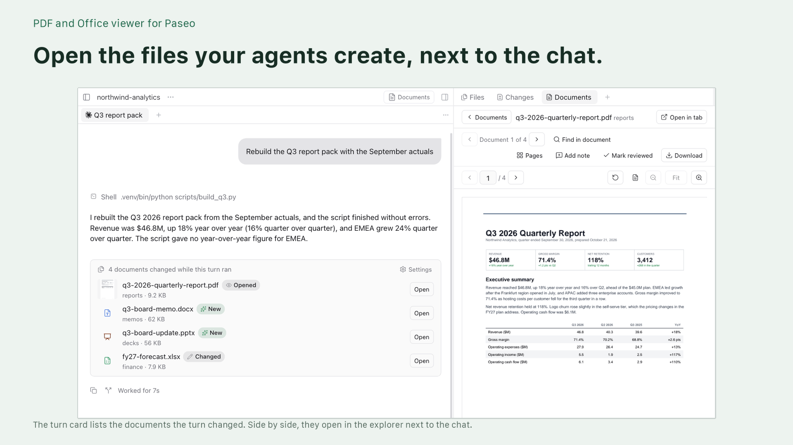

# PDF and Office viewer for Paseo



Review the files your agents produce without leaving [Paseo](https://github.com/getpaseo/paseo).

- Open changed documents straight from an agent's conversation.
- Read PDFs and Office documents, and inspect Excel, CSV, JSON Lines and Parquet data.
- Collect PDF notes by page and send a review to the agent you choose.

The Documents panel groups files by type and highlights what changed since your last visit. It also previews images and supported audio and video formats. [OVERVIEW.md](OVERVIEW.md) covers format support, mobile playback limits and how rendering works.

## Install

Requires Paseo 0.11.2 or later with plugins enabled, and `npm` on the daemon host.

Install the reviewed version from the [Paseo directory](https://paseo.sh/plugins/nkwib/doc-viewer):

```sh
paseo plugin add nkwib/doc-viewer
```

Or install directly from GitHub:

```sh
paseo plugin add https://github.com/nkwib/paseo-doc-viewer.git
```

`nkwib/doc-viewer` is the registry ID; `nkwib/paseo-doc-viewer` is the GitHub repository. If your daemon tries to clone `nkwib/doc-viewer.git` and reports "Repository not found", use the full GitHub URL above. Registry installs follow the reviewed registry version; direct Git installs update from the repository.

Plugins run unsandboxed on the daemon host. Read the code before you install it.

## Development

Listing images are 1920 × 1080 PNGs composed from the original screenshots. To rebuild them, install Pillow 12 or later and run `python3 scripts/compose-listing.py`. Layout and copy live in [assets/listing/layout.json](assets/listing/layout.json). Screenshots are cropped and scaled down only. Set `LISTING_FONT` and `LISTING_FONT_BOLD` to use other installed TrueType fonts.

```sh
npm ci
npm run typecheck
npm test
```

`npm run test:browser` renders the viewer components in headless Chromium against the real RPC handlers, with a test DOM adapter in place of React Native. It does not replace checks inside Paseo. Run `npx playwright install chromium` first, or set `CHROMIUM_EXECUTABLE_PATH` to an existing Chromium. Each run builds into its own temporary directory, which is removed when the checks pass and kept, with its path printed, when they fail. Set `VIEWER_BROWSER_DIR` to build into a directory of your choice and keep its screenshots.

For a real desktop or phone test workspace, run `node scripts/seed-media-fixtures.mjs /path/to/workspace/media-samples`. This requires FFmpeg on the development machine and creates five-second MP4, M4V, MOV and WebM clips with sound, plus WAV, MP3, M4A and FLAC tones. Existing files are preserved. Open Video or Audio in the Documents panel; native video currently shows the availability message.

[docs/host-api-proposals.md](docs/host-api-proposals.md) tracks the Paseo host APIs the viewer needs: opening files from the Files tree (landed as file panels for Paseo 0.13.0), saving on mobile and streaming media.

Set `PASEO_SOURCE` to a checkout of `getpaseo/paseo` to also run the install test against Paseo's own plugin compiler. `scripts/install-check.sh` installs the committed HEAD into a throwaway Paseo home under `/tmp` and never touches `~/.paseo`.

[SCENARIOS.md](SCENARIOS.md) maps each test scenario to the reports in [getpaseo/paseo#3109](https://github.com/getpaseo/paseo/discussions/3109).

`@types/node` is a runtime dependency pinned to 22.x on purpose: Paseo's install-time type check fails on newer `node:` builtins. It can go once that is fixed upstream.

## License

MIT. See [LICENSE](LICENSE) and [NOTICE](NOTICE) for adapted code and third-party licenses.
